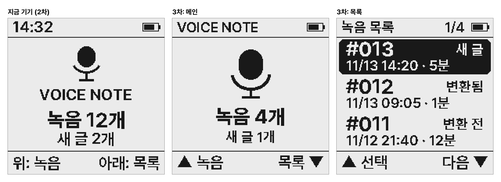
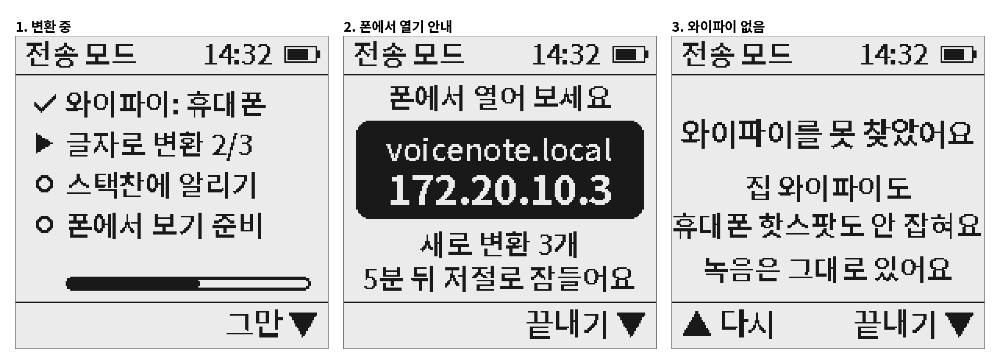

# VOICE NOTE

버튼 두 개로 쓰는 작은 전자종이 녹음기예요. 녹음하고, 와이파이에 연결하면 글자로 바꿔서 폰이나 컴퓨터(맥·윈도우)의 웹 브라우저에서 볼 수 있어요. 앱 설치는 필요 없어요.



## 할 수 있는 것

- **녹음**: ▲ 한 번에 시작, 한 번 더 누르면 멈춤. SD카드에 저장해요(16kHz WAV). SD카드 남은 공간만큼 녹음할 수 있어요 (1GB에 약 9시간).
- **기기에서 듣기**: 목록에서 골라 스피커로 재생해요.
- **전송 모드** (메인에서 ▼ 길게)
  1. 집 와이파이에 연결해요. 안 되면 폰 핫스팟에 연결해요.
  2. 아직 변환 안 한 녹음을 글자로 바꿔요 (OpenAI Whisper). 10분 넘는 녹음은 나눠서 보내요.
  3. (AssemblyAI 키가 있으면) 누가 말했는지 화자를 나눠요.
  4. 화면에 접속 주소(`voicenote.local`과 IP)를 보여 줘요.
- **웹페이지** (폰·컴퓨터 브라우저): 녹음 목록(글 앞부분 미리보기), 글 전체 보기, 글 복사, TXT 저장, 브라우저로 듣기, 요약, 화자별 보기, 삭제(하나씩 / 여러 개).
- **배터리 표시**, 5분 동안 안 쓰면 **저절로 꺼짐** (아래 버튼으로 다시 켜요).



## 필요한 것

- 보드: **Waveshare ESP32-S3-ePaper-1.54 (V2)** — ESP32-S3-PICO-1 N8R8, 1.54인치 전자종이, ES8311 오디오, SD카드 슬롯. 핀 배치는 [`PINS.md`](PINS.md).
  - 구매 링크: [AliExpress](https://s.click.aliexpress.com/e/_c3tW1KbP) (제휴 링크예요. 이 링크로 사시면 저에게 소정의 수수료가 들어와요.)
- microSD 카드 (FAT32)
- OpenAI API 키 (글자 변환·요약)
- AssemblyAI API 키 (화자 나누기, 없어도 됨)

## 굽는 방법 (macOS 기준)

아래 명령은 맥 기준이에요. arduino-cli는 윈도우·리눅스에도 있어서 같은 순서로 할 수 있지만, 직접 시험하지는 않았어요.

1. 도구 설치

   ```bash
   brew install arduino-cli
   arduino-cli core install esp32:esp32@3.3.11
   arduino-cli lib install U8g2 ArduinoJson
   ```

2. 와이파이·키 넣기. 질문에 차례로 답하면 `firmware/voicenote/secrets.h`가 만들어져요. 이 파일은 git에 올라가지 않아요.

   ```bash
   tools/setup_secrets.sh
   ```

3. 보드를 USB로 연결하고 포트 이름 확인

   ```bash
   ls /dev/cu.usbmodem*
   ```

4. 컴파일 + 굽기 (포트 이름은 3번에서 본 것으로)

   ```bash
   tools/build.sh /dev/cu.usbmodem1101
   ```

## 쓰는 법

| 화면 | ▲ 위 버튼 | ▼ 아래 버튼 |
|---|---|---|
| 메인 | 녹음 시작 | 짧게: 목록 / 길게: 전송 모드 |
| 녹음 중 | 멈춤·저장 | — |
| 목록 | 열기 | 짧게: 다음 / 길게: 메인 |
| 녹음 보기 | 재생 | 목록으로 |
| 재생 중 | 멈춤 | 목록으로 |
| 전송 모드 | — | 그만 / 끝내기 |

- 폰 핫스팟을 쓸 때 아이폰은 **설정 → 개인용 핫스팟 → 호환성 최대화**를 켜 주세요 (기기는 2.4GHz만 잡아요).
- 웹페이지는 기기와 **같은 와이파이**에 있는 폰이나 컴퓨터의 브라우저에서 열어요. `voicenote.local`이 안 열리면 화면의 IP 숫자로 열어요.

## SD카드에 저장되는 파일

```
/notes/rec_013.wav      녹음
/notes/rec_013.txt      글자로 바꾼 글
/notes/rec_013.sum.txt  요약
/notes/rec_013.spk.txt  화자별 글
```

## 비용 (2026년 11월 기준, 대략)

| 기능 | 서비스 | 대략 |
|---|---|---|
| 글자 변환 | OpenAI `whisper-1` | 1분에 약 10원 |
| 요약 | OpenAI `gpt-6-luna` | 한 번에 1원 미만 |
| 화자 나누기 | AssemblyAI `universal-2` | 1시간에 약 250원 |

## 알아 둘 점

- 화자 나누기는 기기가 녹음을 AssemblyAI로 올리는 데 시간이 걸려요 (2분 녹음에 약 1분). 보드의 기본 네트워크 설정 때문이에요. 그래서 올릴 때만 소리를 반 크기(μ-law)로 줄여 보내요. SD카드의 녹음은 그대로예요.
- 10분 넘는 녹음을 나눠서 변환하는 기능은 아직 실제로 시험하지 않았어요.
- 한국어 화자 나누기는 직접 시험해서 동작을 확인했지만, AssemblyAI 문서에 한국어 지원이 따로 적혀 있지는 않아요.

## 폴더

```
firmware/voicenote/  펌웨어 (Arduino)
web/index.html       웹페이지 원본 → tools/make_web.py 로 펌웨어에 넣음
tools/               굽기, 키 넣기, 글꼴 만들기, 화면 시안 도구
design/              화면 시안 그림
```

## 라이선스

MIT — [`LICENSE`](LICENSE). 오디오 칩 드라이버(Apache-2.0)와 글꼴(SIL OFL 1.1)은 [`THIRD_PARTY.md`](THIRD_PARTY.md)를 보세요.

---

### English

VOICE NOTE is a two-button e-paper voice recorder firmware for the Waveshare ESP32-S3-ePaper-1.54 (V2). It records to SD card. Long-press the bottom button to connect to Wi-Fi (home first, then phone hotspot). The device then transcribes new recordings with OpenAI Whisper, streaming them from SD and splitting recordings over 10 minutes. It can also split speakers with AssemblyAI. The device serves a web page at `voicenote.local` with the note list, full text, copy, TXT download, playback, summary (OpenAI), speaker view, and delete. Build with `arduino-cli` (esp32 core 3.3.11, U8g2, ArduinoJson). Put your Wi-Fi and API keys in with `tools/setup_secrets.sh`, then flash with `tools/build.sh <port>`. MIT licensed. See `THIRD_PARTY.md` for the Espressif ES8311 driver (Apache-2.0) and the Noto Sans KR font (OFL 1.1).
